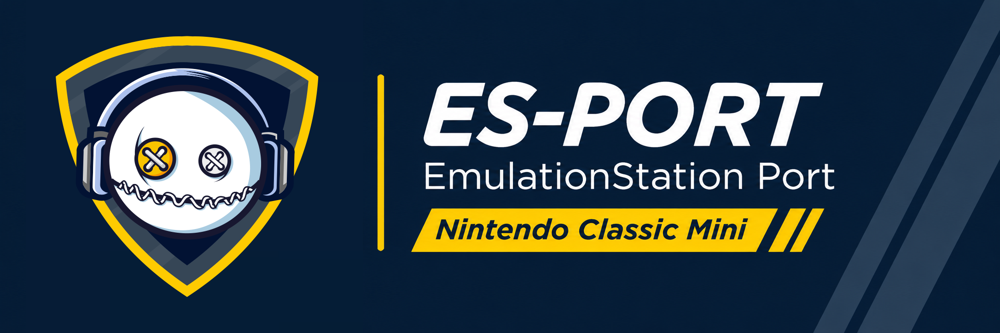

# ES-PORT: EmulationStation for the NES/SNES Classic

[](https://github.com/DefKorns/es-port/actions/workflows/build.yml)
[](https://github.com/pre-commit/pre-commit)
[](../LICENSE.md)



ES-PORT replaces Clover-UI, the stock home menu of the NES Classic and SNES Classic, on a hakchi-modded console with
[EmulationStation](https://emulationstation.org) 2.12 (the RetroPie fork). It lists the games you sync with hakchi,
grouped by system, with covers, descriptions, favorites and themes, and starts them with the console's own RetroArch.
It ships as the `emulationstation_classicmini` hmod. Branch `classicmini`, based on `stable` (`a31c36a`, v2.12.0
merge); `upstream` is `RetroPie/EmulationStation`.

## What it does

- **Browses what hakchi syncs.** On boot it builds a library from the games in hakchi's storage. Each game is put in
  its system by the emulator it launches (about 56 systems are defined, and only those with games are shown). CHD
  discs are told apart by their contents: DVD images go to PSP and CD images go to PSX or Sega CD.
- **Looks like a real front end.** A systems carousel, then per system a grid of covers with the title, game code, genre
  and description. Favorites, last played and all-games collections, sorting, and themes (see below).
- **Covers.** Matched from `/media/data/emulationstation/covers` by game code, alias or name. A reduced copy with
  the same file name in `covers_small` is preferred when it exists, which keeps the grid smooth on the console.
  [`classicmini/tools/prepare_covers.py`](../classicmini/tools/prepare_covers.py) shrinks a folder of covers to a given width (512 by default). The built-in scrapers work
  over HTTPS with a bundled CA bundle.
- **Suspend points.** Press down on a game to open its suspend point list: four slots with a screenshot and play time,
  save the last session into a slot, resume from one, lock or delete it. They use the same folders as Clover-UI,
  so slots are shared with it, and so are the save files.
- **Launches games through RetroArch.** The game is started with the same arguments as the stock launcher (save file,
  title code, rollback recording), then ES comes back when the game is closed.
- **Controllers.** The console's own pads (Clovercon) and USB pads work in the menus. The pad type (SNES or NES)
  decides which buttons resume and save a suspend point.
- **Stays out of your way.** Hold **Select** while the console boots to get Clover-UI. If EmulationStation crashes
  twice in a row right after starting, the next boot goes to Clover-UI by itself. The power slider shows the shutdown
  screen, and restarting from the menu shows the restart screen.

Not supported: video playback (libvlc is removed, so the `video` view style only shows the snapshot) and anything that
needs more than the console's 256 MB of memory.

## Install

1. Install the **RetroArch (S)NESCE** hmod (the libretro cores and the `retroarch` launcher) and sync your games with
   hakchi. The RetroArch build from KMFDManic may work as well; it has not been tested.
2. Put an SD card or USB stick in the console. The hmod needs one: it installs its default theme,
   [es-theme-simple](https://github.com/RetroPie/es-theme-simple), to `/media/data/emulationstation/themes/simple` and
   stops without installing anything when there is none. hakchi may still report the install as done; the reason is in
   its log.
3. Install `emulationstation_classicmini.hmod` with hakchi and sync. The first boot builds the library, which takes a
   while on large collections.
4. Optional: extra themes go in the same `themes` folder. The Cross Stitch theme is a separate repository
   (`es-theme-cross-stitch`).

It is developed and tested on a SNES Classic. The NES Classic has the same hardware and the code handles both pads, but
it has seen much less testing.

Uninstalling the hmod removes EmulationStation, its settings and library cache from the NAND and keeps `favorites.txt`.
On the SD card or USB stick it removes the files of the default theme that you did not change and keeps the ones you
edited or added. Updating the hmod keeps your edits too.

## Using it

| Where | Buttons |
| --- | --- |
| Systems | left/right choose, A open, X random game, Start menu |
| Games | left/right browse, A play, B back to systems, Y sort, down suspend points, up the header menu |
| Suspend points | left/right slot, A resume (Start on NES), Y save (A on NES, hold to overwrite), down lock, Select delete, B back |

The header icons open the menu: Display, System, Network, Library and Help. UI Settings has the theme, the games view
style and the screensaver.

## Themes

A theme is an ordinary EmulationStation theme (see [`THEMES.md`](../THEMES.md)) with a few additions that this port reads:

- `imagegrid`: `scrollDuration` (ms) and `adjacentGap` (fraction of the screen width between the selected cover and
  its neighbors). `carousel`: `scrollDuration`.
- `menuIcons` container: where the header icon bar goes, in the systems and the games views. The bar is only drawn
  when the theme defines this container; without it there are no icons and the menu opens with Start.
- Games view: `md_divider`, `md_arrow_left`, `md_arrow_right` and `md_scrollbar` images. The arrows only show when the
  list has more games than fit. A game without description uses the `md_name_nodesc`, `md_developer_nodesc` and
  `md_genre_nodesc` layouts and hides the divider.
- Suspend point list: `suspend_panel`, `suspend_cell`, `suspend_cell_selected`, `suspend_frame`,
  `suspend_frame_selected` (each an `image` stretched to its box, or a `ninepatch`), `suspend_shot`, `suspend_lock`,
  `suspend_gauge`, `suspend_cell_next` (where the second cell goes, which sets the spacing), and `suspend_title`,
  `suspend_label` and `suspend_notice` (position, text color, font and size).
- The `favoriteIconVisible` theme variable: the game list shows a heart before the name of a favorite unless the theme
  sets it to `false`.
- `nandSpace`, `diskSpace` and their icons: the free space of the NAND and of the SD card.
- A theme `ui/` folder overrides the built-in menu icons (`menu_*.svg`), the highlight (`menu_selected.png`) and the
  suspend point art.

With no theme or no such elements the port keeps its built-in look.

## Build

```sh
classicmini/build.sh
cd classicmini/hmod
sh stage.sh
sh ../../vendor/hmod-build/docker-make.sh
```

Only docker is needed on the host. The build runs in `classicmini-es-toolchain`, built from `Dockerfile.es-armhf` in
[classicmini-cross-toolchain](https://github.com/DefKorns/classicmini-cross-toolchain) on top of the shared toolchain
image (GCC 4.9.4 / glibc 2.21 for Cortex-A7, the console's SDL2 2.0.4, FreeType, ALSA, static libcurl on mbedTLS). The
ES image adds CMake 3.27, static FreeImage, RapidJSON and link stubs for `libGLESv2`; nothing is taken from a console.
`ES_TOOLCHAIN_IMAGE` selects another tag (default `classicmini-es-toolchain:local`).

[`classicmini/scripts/build-es.sh`](../classicmini/scripts/build-es.sh) runs inside the container with the repository mounted: it fetches the `pugixml` submodule,
configures with `-DGLES=ON`, builds and strips. The build tree stays in `classicmini/out/.build` so rebuilds are
incremental. ES's CMake writes the `emulationstation` binary into the repository root; it is ignored by git.

Result in `classicmini/out/`: `emulationstation` (stripped ARM hard-float ELF, about 8 MB) and `libfreetype.so.6`, which
ships with the program. At run time it needs the console's `libSDL2.so`, `libasound.so.2` and `libGLESv2.so`.
`stage.sh` collects the binary, scripts and resources into `mod/`; the hmod lands in `out/`.

## Changes against `stable`

- libvlc removed: the video component is a stub that shows the snapshot image.
- `std::put_time` replaced by `strftime` (libstdc++ 4.9 has none).
- `SDL_JoystickGetVendor/Product` guarded (SDL 2.0.4 on the console has none).

The rest of this repository is EmulationStation itself; the port is what lives in `classicmini/` and the small hooks it
needs in `es-app` and `es-core`.

## Credits

See [`classicmini/ATTRIBUTION.md`](../classicmini/ATTRIBUTION.md) for the fonts, the CA bundle and the other third-party pieces. EmulationStation is by Alec Lofquist
and the RetroPie project, under the MIT license ([`LICENSE.md`](../LICENSE.md)).
